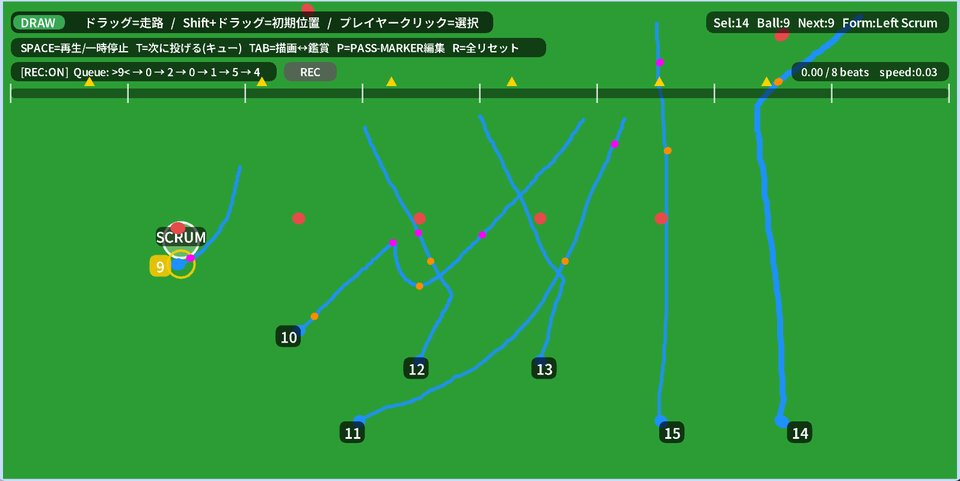

# ScrumCanvas

ラグビーの戦術を3Dで組み立てて再生するシミュレーター。Processing原版とp5.js移植版。

[作品を見る](https://eisuke29.github.io/portfolio/work1.html) · [ポートフォリオ](https://eisuke29.github.io/portfolio/)



## できること

選手を配置し、移動経路やボールの受け渡しを組み立て、戦術を再生できます。2025年9月12日のEP演習成果発表で公表した個人制作です。

## 収録内容

- `web/play/scrumcanvas/`：p5.jsへ移植したブラウザ版
- `processing/ep_2_9_final/`：元のProcessingスケッチと日本語フォント

## ローカルで動かす

このリポジトリのフォルダで次を実行し、http://localhost:8000/ を開きます。

```sh
python -m http.server 8000
```

Processing原版はProcessing 4で `processing/ep_2_9_final/ep_2_9_final.pde` を開きます。Web版は画面上のボタンとマウスで操作します。


## 制作者・権利

木下瑛介 / Eisuke Kinoshita（[Eisuke29](https://github.com/Eisuke29)）。共同制作・外部素材については上記の説明を参照してください。自作のコード・映像・デザインについて、別途記載のない限り無断での再配布は許諾していません。外部ライブラリ・モデル・フォント等にはそれぞれのライセンスが適用されます。
